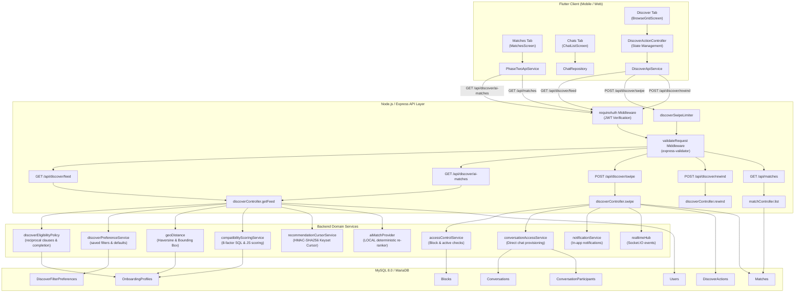
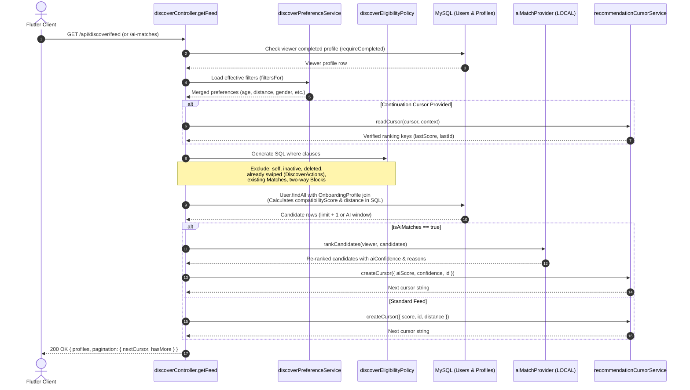
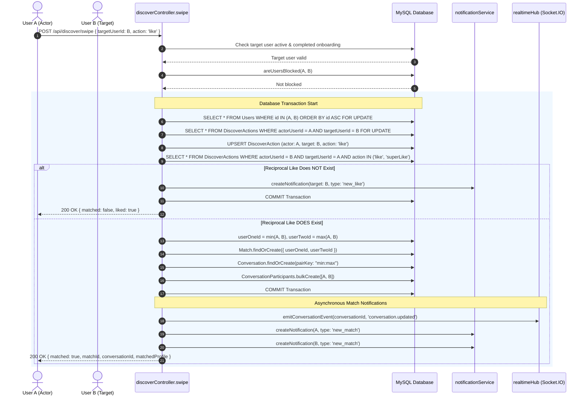
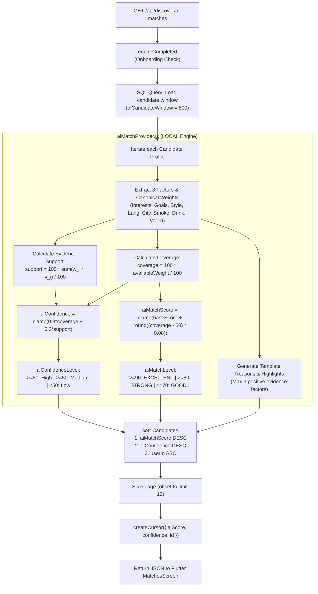

# AMORAA — Match Engine Data Flow & Technical Trace

**Project:** AMORAA Dating Application  
**Repository:** `D:\Projects\amora_ai`  
**Document:** Match Engine Complete Data Flow Architecture  
**Mode:** Strictly Read-Only Audit Trace

---

## 1. System Architecture Diagram



---

## 2. Flutter-to-Backend Request Flow

### 2.1 Standard Discover Feed Request Flow
1. **Trigger:** `BrowseGridScreen` mounts or user exhausts available card stack.
   - Code location: [`lib/features/discover/presentation/browse_grid_screen.dart:237`](file:///d:/Projects/amora_ai/lib/features/discover/presentation/browse_grid_screen.dart#L237)
2. **Client API Call:**
   - Invokes `DiscoverApiService.getFeed(cursor, limit: 10, communicationStyles, surface: 'recommended')`.
   - Attaches `Authorization: Bearer <amora_access_token>`.
3. **HTTP Transport:**
   - `GET /api/discover/feed?limit=10&cursor=<token>`
4. **Backend Route & Middleware:**
   - Middleware chain: `requireAuth` $\to$ `feedValidation()` $\to$ `validateRequest` $\to$ `discoverController.getFeed`.
   - File: [`Backend/src/routes/discoverRoutes.js:16-17`](file:///d:/Projects/amora_ai/Backend/src/routes/discoverRoutes.js#L16-L17)
5. **Response Payload:**
   - Returns `{ success: true, message: 'Discover feed retrieved.', data: { profiles: [...], pagination: { hasMore, nextCursor } } }`.
6. **Client Ingestion:**
   - `BrowseGridScreen` converts JSON to `DummyProfile` objects via `publicProfileFromJson()`.
   - Passes profile IDs into `DiscoverActionController` deck.

### 2.2 AI Matches Feed Request Flow
1. **Trigger:** User opens "Matches" tab in navigation shell.
   - Code location: [`lib/features/matches/presentation/matches_screen.dart:184-218`](file:///d:/Projects/amora_ai/lib/features/matches/presentation/matches_screen.dart#L184-L218)
2. **Client API Call:**
   - Invokes `PhaseTwoApiService.instance.aiRecommendations(cursor, limit: 10)`.
   - File: [`lib/core/api/phase_two_api_service.dart:113-140`](file:///d:/Projects/amora_ai/lib/core/api/phase_two_api_service.dart#L113-L140)
3. **HTTP Transport:**
   - `GET /api/discover/ai-matches?limit=10&cursor=<token>`
4. **Backend Route Execution:**
   - File: [`Backend/src/routes/discoverRoutes.js:18`](file:///d:/Projects/amora_ai/Backend/src/routes/discoverRoutes.js#L18)
   - Interceptor sets `req.aiMatches = true; req.query.surface = 'high_compatibility';` then calls `discoverController.getFeed`.
5. **Backend Processing:**
   - Queries bounded candidate window (up to 500 candidates via `aiCandidateWindow()`).
   - Executes `rankCandidates()` in [`aiMatchProvider.js:62`](file:///d:/Projects/amora_ai/Backend/src/services/aiMatchProvider.js#L62).
   - Generates deterministic `aiMatchScore`, `aiConfidence`, `aiHighlights`, and `aiReasons`.
6. **Client Ingestion:**
   - Converts recommendations to `MatchApiItem` list in `MatchesScreen`.

---

## 3. Recommendation Generation & Filtering Flow



---

## 4. Filtering and Ranking Logic Details

### Step 1: SQL Pre-Filter Formulation
In [`discoverController.js:301-377`](file:///d:/Projects/amora_ai/Backend/src/controllers/discoverController.js#L301-L377), Sequelize generates a single monolithic query with:
1. `User.id NOT IN (SELECT targetUserId FROM DiscoverActions WHERE actorUserId = viewer.id)`
2. `User.id NOT IN (SELECT otherUserId FROM Matches WHERE viewer is participant)`
3. `User.accountStatus = 'active'`
4. `NOT EXISTS (SELECT 1 FROM Blocks WHERE blocker = viewer AND blocked = candidate OR vice-versa)`
5. `OnboardingProfile.birthDate BETWEEN dateFor(maxAge+1) AND dateFor(minAge)`
6. `OnboardingProfile.gender IN (viewer.interestedIn)`
7. `viewer.gender IN (OnboardingProfile.interestedIn) OR OnboardingProfile.interestedIn IS NULL`
8. `OnboardingProfile.matchLatitude BETWEEN minLat AND maxLat` (if distance filter active)
9. Correlated reciprocal age check: `viewerAge BETWEEN candidate.minAge AND candidate.maxAge`
10. Correlated reciprocal distance check: `distance <= candidate.maxDistanceKm`

### Step 2: In-Query Compatibility Scoring
In [`compatibilityScoringService.js:153-199`](file:///d:/Projects/amora_ai/Backend/src/services/compatibilityScoringService.js#L153-L199):
- Scalar factors (`city`, `smoking`, `drinking`, `weed`, `communicationStyle`) evaluate exact equality in SQL `CASE` expressions.
- List factors (`interests`, `relationshipGoals`, `languages`) evaluate element overlap using `JSON_TABLE` (MySQL 8) or sequence tables (MariaDB 10.4).
- The final score is computed as:
  ```sql
  LEAST(100, GREATEST(0, ROUND(50 + (weightedAgreement) - ((availableWeight) / 2))))
  ```

### Step 3: Order and Pagination
- **Standard Feed:**
  ```sql
  ORDER BY compatibilityScore DESC, User.id ASC
  LIMIT 11
  ```
- **Near You Feed:**
  ```sql
  ORDER BY ROUND(distanceKm, 6) ASC, compatibilityScore DESC, User.id ASC
  LIMIT 11
  ```
- **AI Matches:**
  Query limit is set to `aiCandidateWindow` (default 500). In-memory JavaScript sorting:
  ```javascript
  candidates.sort((a, b) => b.aiMatchScore - a.aiMatchScore || b.aiConfidence - a.aiConfidence || a.id - b.id)
  ```

---

## 5. Like / Pass / Super Like Lifecycle



---

## 6. Mutual-Match Creation Flow

When a mutual match occurs during `swipe()`:
1. **Canonical ID Ordering:**
   - `userOneId = Math.min(Number(req.user.sub), targetUserId)`
   - `userTwoId = Math.max(Number(req.user.sub), targetUserId)`
   - File: [`Backend/src/controllers/discoverController.js:594-595`](file:///d:/Projects/amora_ai/Backend/src/controllers/discoverController.js#L594-L595)
2. **Match Entity Creation:**
   - Table: `Matches`
   - Fields: `userOneId`, `userTwoId`, `matchedAt: NOW()`.
   - Handled with `Match.findOrCreate` to guarantee idempotency.
3. **Direct Conversation Provisioning:**
   - Service: [`conversationAccessService.ensureDirectConversation(userOneId, userTwoId)`](file:///d:/Projects/amora_ai/Backend/src/services/conversationAccessService.js#L57-L83)
   - Generates deterministic unique `pairKey = "${userOneId}:${userTwoId}"`.
   - Inserts row in `Conversations` (`type = 'direct'`).
   - Inserts 2 rows in `ConversationParticipants` (`joinedAt: NOW()`).
4. **Realtime & Push Notification Fan-Out:**
   - Emits Socket.IO room broadcast: `conversation.updated`.
   - Creates in-app notifications in `Notifications` table with deduplication keys:
     - Actor: `match:${matchId}:${actorUserId}`
     - Target: `match:${matchId}:${targetUserId}`
5. **Client Redirection:**
   - Flutter `DiscoverActionController` receives `matched: true`.
   - Triggers `ChatRepository.instance.refreshConversations()`.
   - Shows match dialog / celebration card on top of the swipe deck.

---

## 7. AI Compatibility Flow (LOCAL Provider)



---

## 8. Database Interaction Flow

| Table Name | Operation in Match Engine | Transactional? | Locks Held | Notes |
| :--- | :--- | :---: | :---: | :--- |
| `Users` | `SELECT ... FOR UPDATE` | Yes (in `swipe`) | Row lock on actor and target IDs | Prevents deadlocks by enforcing `ORDER BY id ASC`. |
| `OnboardingProfiles` | `SELECT` (joined in `getFeed`) | No | None (Shared read) | Correlated subqueries evaluate JSON arrays. |
| `DiscoverActions` | `SELECT ... FOR UPDATE`, `UPSERT` | Yes (in `swipe`) | Row lock | Enforces one action per user pair via unique index. |
| `Matches` | `findOrCreate` | Yes (in `swipe`) | Table/Index lock on insert | Created only when reciprocal action found. |
| `Conversations` | `findOrCreate` | Yes (in `swipe`) | Table/Index lock on insert | Unique `pairKey` prevents duplicate chats. |
| `ConversationParticipants` | `bulkCreate` | Yes (in `swipe`) | Row locks on insert | Attaches both users to the conversation. |
| `Blocks` | `SELECT` (anti-join in `getFeed`) | No | None (Read) | Hides blocked candidates from discovery. |
| `DiscoverFilterPreferences`| `SELECT`, `UPSERT` | No (in `updateFilters`) | None | Stores user's custom filter settings. |
| `Notifications` | `create` | Yes (in `swipe`) | Row lock on insert | Deduplication keys prevent duplicate alerts. |
| `MatchingActionFailures` | `create` | No | None | Logs business rejections (self-swipe, blocked). |
