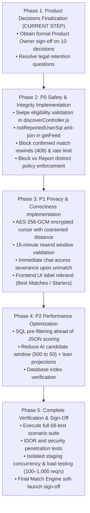

# AMORAA — Match Engine Decisions Finalization Summary

**Document:** `AMORAA_MATCH_ENGINE_FINALIZATION_SUMMARY.md`  
**Project:** AMORAA Dating Application  
**Repository:** `D:\Projects\amora_ai`  
**Author:** DeepMind Agentic Coding Assistant (Antigravity)  
**Date:** November 2026  
**Status:** READ-ONLY FINALIZATION SUMMARY (Awaiting Product Owner Approval)

---

## 1. Executive Summary & Compliance Statement

This document provides a concise governance summary of the finalized Match Engine product decisions register ([`AMORAA_MATCH_ENGINE_PRODUCT_DECISIONS.md`](file:///d:/Projects/amora_ai/AMORAA_MATCH_ENGINE_PRODUCT_DECISIONS.md)). 

> [!IMPORTANT]
> **Explicit Verification Statement:** In strict adherence to project safety rules, **NO application source code (Flutter or Node.js), configuration files, database records, or database schemas have been modified, deployed, or executed**. This phase has been conducted purely as a read-only analysis and architectural finalization task.

---

## 2. Summary of All 10 Decisions & Recommended Defaults

| Decision # | Core Question | Recommended Default | Key Operational Rationale | Approval Status |
| :---: | :--- | :--- | :--- | :---: |
| **D-01** | Should a report immediately suppress the user from discovery? | **Option 1B: Immediate Mutual Suppression** | Prevents trauma and harassment; hides reported profile immediately from reporter's discovery feed. | `PENDING APPROVAL` |
| **D-02** | How should incomplete reciprocal preferences be handled? | **Option 2B: Strict Reciprocal Exclusion** | Excludes candidates who haven't selected viewer's gender; prevents mismatched orientations. | `PENDING APPROVAL` |
| **D-03** | Should confirmed mutual matches be rewindable? | **Option 3B: Disallowed (Return 409)** | Confirmed matches are milestones; prevents half-orphaned database states and user confusion. | `PENDING APPROVAL` |
| **D-04** | How should chat history be handled upon unmatch? | **Option 4B: Access Severed + Configurable Retention** | Revokes access immediately; leaves retention duration configurable pending formal legal review. | `PENDING APPROVAL` |
| **D-05** | Should "AI Matches" be rebranded? | **Option 5B: Rebrand to "Best Matches"** | Truth in advertising; eliminates regulatory exposure since matching is deterministic math. | `PENDING APPROVAL` |
| **D-06** | How should the "AI Confidence" metric be treated? | **Option 6B: Rename to "Profile Match Depth"** | Accurately describes the formula (80% profile completeness + 20% factor support). | `PENDING APPROVAL` |
| **D-07** | Should "AI Openers" be rebranded? | **Option 7B: Rename to "Conversation Starters"** | Aligns with existing on-device disclosure; openers are static template strings. | `PENDING APPROVAL` |
| **D-08** | What is the long-term AI architecture roadmap? | **Option 8A: Hybrid Architecture (Phase 3)** | Keep deterministic rules for hard filters; introduce vector embeddings post-launch in Phase 3. | `PENDING APPROVAL` |
| **D-09** | What is the permitted rewind time window? | **Option 9B: 15-Minute Expiration Window** | Protects immediate accidental swipes while preventing stale historical manipulation. | `PENDING APPROVAL` |
| **D-10** | How should BLOCK and REPORT be separated? | **Option 10B: Distinct Separation** | **Block:** complete instant bilateral severance. **Report:** reporter suppression + moderation ticket + optional block prompt. | `PENDING APPROVAL` |

---

## 3. Detailed Revisions from Audit Baseline

### Revision to Decision 10 (Separation of BLOCK vs. REPORT)
Previously, Block and Report were analyzed as a single lumped concept. They have now been given distinct technical specifications:
- **BLOCK Policy (Immediate Bilateral Severance):** Match deleted/revoked, conversation access severed, bilateral discovery suppression, socket subscriptions dropped, push notifications stopped, and API circumvention prevented.
- **REPORT Policy (Community Moderation & Safety):** Unilateral suppression from reporter's feed, administrative moderation case opened with audit trail, **no automatic account suspension**, and **no automatic bilateral match severance** unless the reporter also opts into the Block policy. This eliminates the risk of weaponized false reporting.

### Revision to Decision 4 (Unmatch Chat Retention Governance)
The earlier recommendation of an arbitrary 90-day retention period has been revised. While immediate access revocation remains recommended, retention duration is now identified as an unresolved legal/product policy:
- Avoids claiming that 90 days automatically guarantees compliance with the Digital Personal Data Protection (DPDP) Act or IT Rules.
- Specifies that retention must be configurable (`UNMATCH_RETENTION_DAYS`) and auditable.
- Outlines the exact legal questions that legal counsel must finalize regarding lawful basis, retention schedules by category (text vs. media vs. logs), and the interaction between safety retention and Section 12 erasure requests.

### Revision to Decision 6 (Match Confidence Metric Formulation)
Code inspection of [`Backend/src/services/aiMatchProvider.js:46`](file:///d:/Projects/amora_ai/Backend/src/services/aiMatchProvider.js#L46) confirmed:
$$\text{aiConfidence} = \text{clamp}(0.8 \times \text{coverage} + 0.2 \times \text{support})$$
The metric is mathematically derived from profile data completeness (80%) and factor agreement (20%). It does **not** measure statistical confidence or machine learning probability. The recommendation has been revised to either rename it to **"Profile Match Depth"** / **"Compatibility Data Coverage"**, or remove the metric from the UI for soft launch until validated.

---

## 4. Unresolved Product and Legal Questions

The following specific questions must be answered by the Product Owner and Legal Counsel prior to Phase P1 implementation:

1. **Statutory Retention Duration:** What exact retention period (30, 60, 90, or 180 days) is mandated or permitted by legal counsel for unshared unmatch transcripts under Indian DPDP Act Section 8(7) storage limitation guidelines?
2. **Media Purging Schedule:** Should unshared chat media (photos/voice notes) be deleted sooner than message text metadata (e.g. 14 days vs. 90 days) to minimize biometric/storage liability?
3. **Soft Launch UI Metric Visibility:** Does the Product Owner prefer renaming the confidence metric to "Profile Match Depth" (Option 6B) or removing the badge from match cards entirely for launch (Option 6C)?
4. **Onboarding Hard Gates:** Is the product team prepared to make `interestedIn` (gender preference) a mandatory blocking step during onboarding to enforce strict reciprocal exclusion (Decision 2)?

---

## 5. Implementation Dependency & Prerequisites Matrix

No engineering phase may begin until its required product decisions are approved:

```
┌────────────────────────────────────────────────────────────────────────┐
│                        PHASE APPROVAL GATES                            │
├────────────────────┬───────────────────────────────────────────────────┤
│ Implementation Gate│ Prerequisite Product Decisions Required           │
├────────────────────┼───────────────────────────────────────────────────┤
│ Phase P0 (Safety)  │ • Decision 1 (Immediate Report Suppression)       │
│                    │ • Decision 2 (Strict Reciprocal Preferences)      │
│                    │ • Decision 3 (No Rewind of Confirmed Matches)     │
│                    │ • Decision 10 (Distinct Block vs. Report Policy)  │
├────────────────────┼───────────────────────────────────────────────────┤
│ Phase P1 (Privacy) │ • Decision 4 (Chat History Retention Duration)    │
│                    │ • Decision 9 (15-Minute Rewind Expiration Window) │
│                    │ • Decision 5 ("Best Matches" Rebrand)             │
│                    │ • Decision 6 ("Profile Match Depth" Rebrand)      │
│                    │ • Decision 7 ("Conversation Starters" Rebrand)    │
├────────────────────┼───────────────────────────────────────────────────┤
│ Phase P2 (Perf)    │ • Decision 8 (Hybrid Roadmap Scope Confirmation)  │
└────────────────────┴───────────────────────────────────────────────────┘
```

---

## 6. Phased Match Engine Completion Roadmap



---

## 7. Deliverables Location

- Primary Decisions Register: [`D:\Projects\amora_ai\AMORAA_MATCH_ENGINE_PRODUCT_DECISIONS.md`](file:///d:/Projects/amora_ai/AMORAA_MATCH_ENGINE_PRODUCT_DECISIONS.md)
- Decisions Finalization Summary: [`D:\Projects\amora_ai\AMORAA_MATCH_ENGINE_FINALIZATION_SUMMARY.md`](file:///d:/Projects/amora_ai/AMORAA_MATCH_ENGINE_FINALIZATION_SUMMARY.md)
- Technical Remediation Plan: [`D:\Projects\amora_ai\AMORAA_MATCH_ENGINE_REMEDIATION_PLAN.md`](file:///d:/Projects/amora_ai/AMORAA_MATCH_ENGINE_REMEDIATION_PLAN.md)
- Complete Test Specification: [`D:\Projects\amora_ai\AMORAA_MATCH_ENGINE_TEST_PLAN.md`](file:///d:/Projects/amora_ai/AMORAA_MATCH_ENGINE_TEST_PLAN.md)
