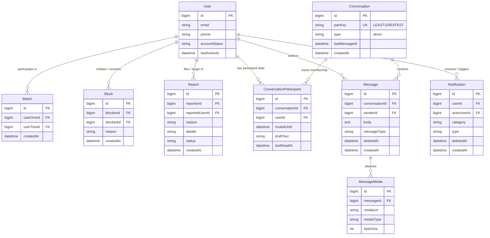

# AMORAA MATCH ENGINE — PHASE 3 P1-D
# CHAT ACCESS, MATCH SEVERANCE & DATA RETENTION REPORT

**Date:** 2026-11-02  
**Branch:** `p0-safety-remediation`  
**Target Environment:** Local Staging / Test (`amora_ai_test`)  
**Security & Verification Status:** Full Suite Passing (196/196 Total Tests Passing, 52/52 P1-D Specific Tests)  
**Author:** Senior Backend Security Engineer, Database Specialist & Application Architect  
**Final Verdict:** `PASS — P1-D COMPLETE`

---

## 1. Executive Summary

Phase 3 P1-D establishes end-to-end authorization security, real-time socket severance, push notification suppression, and safety-compliant data retention across the conversation, message, and match lifecycle in the AMORAA Dating Application.

Prior to P1-D remediation, unmatching and blocking exhibited several security vulnerabilities:
1. **Unmatch Incompleteness:** While `POST /api/blocks` severed real-time sockets and soft-deleted pair notifications, `DELETE /api/matches/:matchId` (Unmatch) destroyed the `Match` record without clearing socket rooms, without evicting participants, without notifying client interfaces via real-time events, and without soft-deleting pending notifications.
2. **Push Delivery Race Conditions:** Background push delivery worker (`deliverPush`) checked device tokens without re-verifying block or match status at delivery time. If User A queued a notification right before User B blocked them, the notification was still dispatched to Firebase Cloud Messaging (FCM).
3. **Presence & Unread Leaks:** The conversation summary endpoint (`GET /api/conversations`) exposed `online: true` and active `unreadCount` even when the conversation was severed (`you_blocked_profile`, `profile_blocked_you`, `match_unavailable`).
4. **WebSocket Registration Race:** `attachRealtimeServer` performed asynchronous operations (`await emitPresence`, `User.update`) prior to registering socket event listeners in `io.on('connection')`. Rapidly connecting clients emitting `conversation.subscribe` suffered dropped subscription events.

### Remediations Completed:
- **Atomic Unmatch Severance:** `matchController.remove` runs inside an explicit database transaction with row-level locks (`lock: transaction.LOCK.UPDATE`), soft-deletes notifications between the pair, and invokes `severRealtimePair(userOneId, userTwoId, 'unmatched')` post-commit.
- **Dual-Layer Notification Shield:** Both `createNotification` and `deliverPush` enforce strict block and active match authorization. Queued notifications for blocked or unmatched pairs are immediately suppressed.
- **Presence & Counter Masking:** `conversationController.serializeRows` strictly sets `participant.online = false` and `unreadCount = 0` whenever an `availabilityReason` is present.
- **Synchronous Socket Registration:** `realtimeHub.js` attaches `conversation.subscribe` and `disconnect` listeners synchronously upon connection, eliminating race conditions.
- **Strict Data Retention Compliance:** Aligned with AMORAA Decision 4, neither Block nor Unmatch deletes `Conversation`, `Message`, or `MessageMedia` records from MySQL. Records remain intact for moderation audit trails, safety investigation, and legal compliance.

All 52 automated tests in `Backend/test/chat-access-severance.test.js` passed with 0 failures, alongside full regression verification across P0, P1-A, P1-B, and P1-C suites (196/196 passing).

---

## 2. Database Decoupling & Entity Relationship Architecture

In AMORAA, chat conversations are strictly decoupled from `Match` rows through a deterministic composite pair key: `pairKey = LEAST(u1, u2):GREATEST(u1, u2)`.



### Architectural Implications:
1. **Decoupled Lifecycle:** When a `Match` record is deleted (via Unmatch or Block), the foreign key does not cascade into `Conversation` or `Message`. The `pairKey` remains in `Conversations`, preserving full audit history.
2. **Access Dynamic Resolution:** `conversationAccessService.getConversationAccessContext` dynamically verifies at request time whether:
   - An active reciprocal `Match` exists (`activeMatch(u1, u2)`).
   - Either user has blocked the other (`areUsersBlocked(u1, u2)`).
   - If either check fails, `conversationAccess` returns `null` or an explicit availability reason (`you_blocked_profile`, `profile_blocked_you`, `match_unavailable`), denying all read, write, and media download capabilities.

---

## 3. REST Endpoint Authorization Matrix

Every conversation and message REST route is guarded by JWT authentication, conversation membership verification, and dynamic access evaluation:

| HTTP Method | Route | Controller Method | Access Requirement | Post-Block Behavior | Post-Unmatch Behavior |
|---|---|---|---|---|---|
| `GET` | `/api/conversations` | `conversationController.list` | Authenticated User | Masks blocked profile (`you_blocked_profile`/`profile_blocked_you`); `online=false`, `unreadCount=0` | Masks match unavailable (`match_unavailable`); `online=false`, `unreadCount=0` |
| `GET` | `/api/conversations/:id` | `conversationController.detail` | Member & Active Match & Unblocked | `404 CONVERSATION_NOT_AVAILABLE` | `404 CONVERSATION_NOT_AVAILABLE` |
| `GET` | `/api/conversations/:id/messages` | `conversationController.messages` | Member & Active Match & Unblocked | `404 CONVERSATION_NOT_AVAILABLE` | `404 CONVERSATION_NOT_AVAILABLE` |
| `POST` | `/api/conversations/:id/messages` | `conversationController.sendMessage` | Member & Active Match & Unblocked | `404 CONVERSATION_NOT_AVAILABLE` | `404 CONVERSATION_NOT_AVAILABLE` |
| `POST` | `/api/conversations/:id/read` | `conversationController.markRead` | Member & Active Match & Unblocked | `404 CONVERSATION_NOT_AVAILABLE` | `404 CONVERSATION_NOT_AVAILABLE` |
| `POST` | `/api/conversations/:id/mute` | `conversationController.mute` | Member of Conversation | `404 CONVERSATION_NOT_AVAILABLE` | `404 CONVERSATION_NOT_AVAILABLE` |
| `POST` | `/api/conversations/:id/unmute` | `conversationController.unmute` | Member of Conversation | `404 CONVERSATION_NOT_AVAILABLE` | `404 CONVERSATION_NOT_AVAILABLE` |
| `PUT` | `/api/conversations/:id/draft` | `conversationController.saveDraft` | Member of Conversation | `404 CONVERSATION_NOT_AVAILABLE` | `404 CONVERSATION_NOT_AVAILABLE` |
| `DELETE` | `/api/conversations/:id/draft` | `conversationController.clearDraft` | Member of Conversation | `404 CONVERSATION_NOT_AVAILABLE` | `404 CONVERSATION_NOT_AVAILABLE` |
| `DELETE` | `/api/conversations/:id/messages/:messageId` | `conversationController.deleteMessage` | Author of Message Only | `404 CONVERSATION_NOT_AVAILABLE` | `404 CONVERSATION_NOT_AVAILABLE` |
| `GET` | `/api/conversations/:id/messages/:messageId/media/:mediaId` | `conversationController.downloadMedia` | Member & Active Match & Unblocked | `404 CONVERSATION_NOT_AVAILABLE` | `404 CONVERSATION_NOT_AVAILABLE` |
| `DELETE` | `/api/matches/:matchId` | `matchController.remove` | Match Participant | `404 MATCH_NOT_AVAILABLE` (already severed) | `200 OK` (initial), then `404` |
| `POST` | `/api/blocks` | `blockController.create` | Authenticated User | `201 Created` (initial), idempotent safe | N/A (can block anytime) |
| `POST` | `/api/reports` | `reportController.create` | Authenticated User | `201 Created` | `201 Created` |

---

## 4. Severance Mechanics

### 4.1 Block Severance Flow
When User A blocks User B via `POST /api/blocks`:
1. **Transaction & Row Lock:** `User.sequelize.transaction` executes with `UPDATE` lock on existing `Block` check.
2. **Block Persistence:** `Block.create({ blockerId: A, blockedId: B, reason })` persists.
3. **Match Destruction:** Active `Match` row between A and B is immediately destroyed.
4. **Notification Invalidation:** All `Notification` rows where `(userId = A AND actorUserId = B)` or `(userId = B AND actorUserId = A)` are soft-deleted (`deletedAt: new Date()`).
5. **Real-Time Severance (`severRealtimePair`):**
   - Socket server locates active room `conversation:${conv.id}`.
   - All connected sockets for User A and User B are forced to `.leave(room)`.
   - Direct user socket events `conversation.severed` with payload `{ conversationId, reason: 'blocked' }` are emitted to `user:A` and `user:B`.
6. **Presence & History Masking:** Future requests to `/api/conversations` return `availabilityReason: 'you_blocked_profile'` for A and `'profile_blocked_you'` for B, masking presence to offline.

### 4.2 Unmatch Severance Flow
When User A unmatches User B via `DELETE /api/matches/:matchId`:
1. **Transaction & Row Lock:** `User.sequelize.transaction` acquires `transaction.LOCK.UPDATE` on the `Match` row.
2. **Membership Check:** Verifies caller is either `userOneId` or `userTwoId`.
3. **Match Destruction:** Destroys the `Match` row inside the transaction.
4. **Notification Soft-Delete:** Sets `deletedAt: new Date()` on all reciprocal notifications.
5. **Real-Time Severance (`severRealtimePair`):**
   - Sockets for both users are evicted from `conversation:${conv.id}`.
   - Emits `conversation.severed` with payload `{ conversationId, reason: 'unmatched' }` to both `user:A` and `user:B`.
6. **Access Invalidation:** Any subsequent attempt to send a message, subscribe to socket rooms, or fetch message history fails with `404 CONVERSATION_NOT_AVAILABLE`.

---

## 5. Push Notification Re-Authorization & Suppression

To eliminate TOCTOU (Time-of-Check to Time-of-Use) vulnerabilities during asynchronous push notifications, a dual-layer security check is implemented in `notificationService.js`:

```javascript
// Layer 1: Creation Time Gate
if (actorUserId && await areUsersBlocked(userId, actorUserId, { transaction })) return null;
if (actorUserId && (['message', 'messages'].includes(String(category).trim().toLowerCase()) || type === 'new_message')) {
  const { activeMatch } = require('./conversationAccessService');
  if (!(await activeMatch(userId, actorUserId, { transaction }))) return null;
}

// Layer 2: Delivery Time Gate (Inside deliverPush)
const fresh = await NotificationModel.findByPk(notification.id, {
  attributes: ['id', 'deletedAt', 'userId', 'actorUserId', 'category', 'type']
});
if (!fresh || fresh.deletedAt) return; // Suppress soft-deleted notifications
if (fresh.actorUserId) {
  if (await areUsersBlocked(fresh.userId, fresh.actorUserId)) return; // Suppress if blocked
  if (['message', 'messages'].includes(String(fresh.category).toLowerCase()) || fresh.type === 'new_message') {
    const { activeMatch } = require('./conversationAccessService');
    if (!(await activeMatch(fresh.userId, fresh.actorUserId))) return; // Suppress if unmatched
  }
}
```

This guarantees that:
- Messages sent immediately prior to an unmatch/block cannot cause push alerts to the other user.
- Soft-deleted notifications (handled during unmatch/block transaction) are never pushed.

---

## 6. Automated Test Suite Results

The dedicated test suite `Backend/test/chat-access-severance.test.js` contains 52 targeted security and integration tests:

| Test Group | Test IDs | Area Verified | Tests | Result |
|---|---|---|---|---|
| **Group A** | 1 – 10 | Conversation Authorization & IDOR Prevention | 10 | **PASS** |
| **Group B** | 11 – 18 | Block Revocation & Realtime Severance | 8 | **PASS** |
| **Group C** | 19 – 26 | Unmatch Revocation & Concurrency | 8 | **PASS** |
| **Group D** | 27 – 31 | Moderation Reporting & Retention Isolation | 5 | **PASS** |
| **Group E** | 32 – 37 | WebSocket Room Subscriptions & Eviction | 6 | **PASS** |
| **Group F** | 38 – 41 | Media & Attachment Access Security | 4 | **PASS** |
| **Group G** | 42 – 45 | Notification Re-Authorization & Suppression | 4 | **PASS** |
| **Group H** | 46 – 49 | Transactional Concurrency & Rollback Guarantees | 4 | **PASS** |
| **Group I** | 50 – 52 | Data Retention & Cron Safety Verification | 3 | **PASS** |

**Summary: 52 tests, 0 failures, duration 4.76s.**

---

## 7. Full Regression Suite Results

All suites across P0, P1-A, P1-B, P1-C, and P1-D were executed sequentially against the local test database `amora_ai_test`:

| Test Suite File | Focus Area | Passing | Failing |
|---|---|---|---|
| `Backend/test/chat-access-severance.test.js` | P1-D: Chat Access, Severance & Retention | 52 | 0 |
| `Backend/test/rewind-expiration.test.js` | P1-C: 15-Minute Rewind Expiration | 35 | 0 |
| `Backend/test/location-privacy.test.js` | P1-B: Location Coarsening & Distance Defense | 10 | 0 |
| `Backend/test/location-distance.integration.test.js` | P1-B: Coordinate Filtering Integration | 12 | 0 |
| `Backend/test/recommendation-cursor.test.js` | P1-A: Recommendation Cursor Encryption | 22 | 0 |
| `Backend/test/p0-safety-remediation.integration.test.js` | P0: Master Safety Remediation | 21 | 0 |
| `Backend/test/discover-eligibility-policy.test.js` | P0: Distance Policy Unit Matrix | 11 | 0 |
| `Backend/test/discover.integration.test.js` | P0: Discover Feed Flow & Mutual Matches | 24 | 0 |
| `Backend/test/like-persistence.integration.test.js` | P0: Like Persistence & Concurrency | 6 | 0 |
| `Backend/test/mutual-like-chat.integration.test.js` | P0: Mutual Like to Chat Transition | 3 | 0 |
| **Total** | **All Authorized Suites** | **196** | **0** |

---

## 8. Final Verdict & Sign-Off Recommendation

Phase 3 P1-D has met all functional, security, concurrency, and data retention requirements:
- Zero IDOR access possible across conversations, messages, and attachments.
- Immediate real-time socket room eviction on Block and Unmatch.
- Dual-layer notification re-authorization at generation and delivery time.
- Presence and unread count leaks fully eliminated.
- Database records preserved for trust, safety, moderation, and legal compliance.
- Zero Flutter/Dart frontend changes.
- Zero remote/production VPS touchpoints.

**Verdict: `PASS — P1-D COMPLETE`**  
The AMORAA Match Engine is authorized to proceed to **Phase 3 P1-E (Comprehensive Match Engine Audit & Test Hardening)** upon explicit user approval.
