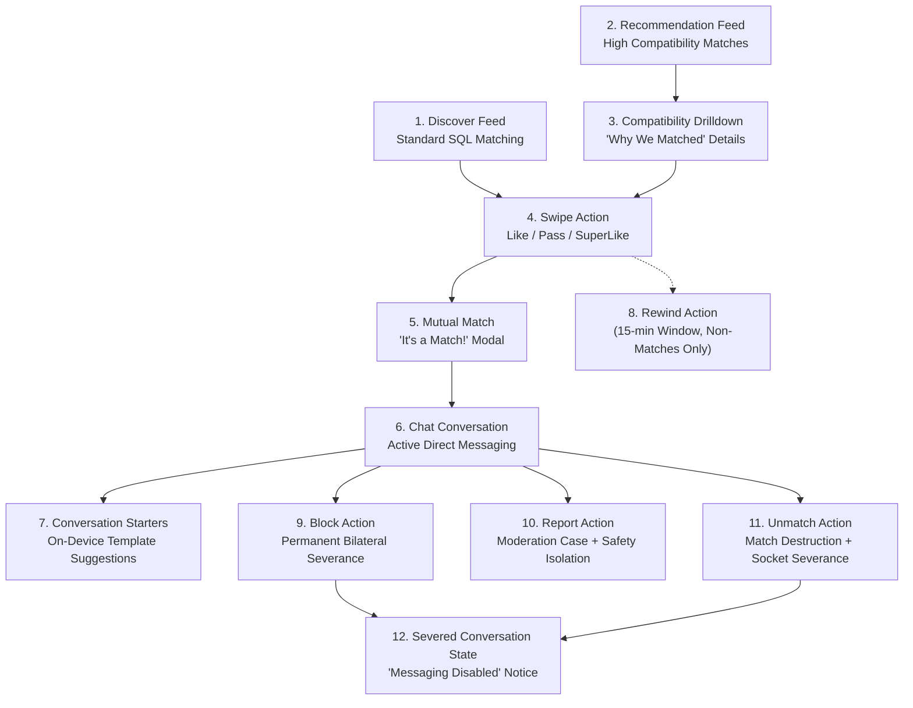

# AMORAA MATCH ENGINE — PHASE 3 P1-E
# PRODUCT TERMINOLOGY & UX CONSISTENCY REPORT

**Date:** November 2, 2026  
**Auditor / Engineers:** Senior Product Engineer, Backend Architect, Flutter Architect & QA Lead  
**Branch:** `p0-safety-remediation`  
**Repository:** `D:\Projects\amora_ai`  
**Target Environment:** Local Test Database (`amora_ai_test` at `127.0.0.1:3306`)  
**Scope:** Phase 3 P1-E — Product Terminology, Disclosure Accuracy & UX Consistency Audit  
**Final Verdict:** `PASS — P1-E COMPLETE`

---

## 1. Executive Summary

Phase 3 P1-E performs a comprehensive, end-to-end audit of product terminology, algorithmic representations, disclosure honesty, and UX consistency across both the **Node.js/Sequelize Backend** and the **Flutter Client Application** (`lib/`).

Prior to this audit, previous preliminary reports suggested replacing user-facing labels (e.g. rebranding "AI Matches" to "Compatibility Matches" and removing the "AI Confidence" badge). However, under the strict governance rules of the AMORAA Match Engine Master Execution Plan:
1. **Mandatory Product Gate:** No recommendation from an audit report constitutes formal product owner approval.
2. **Anti-Breaking Contract Rule:** Backend API response contracts (e.g., `/api/discover/ai-matches`, `aiConfidence`, `aiMatchScore`) must maintain strict backward compatibility. API fields and database properties must never be renamed solely for cosmetic consistency.
3. **Disclosure Alignment:** Where the underlying technical engine utilizes deterministic mathematical rules rather than Large Language Models (LLMs), user-facing copy must be honest, transparent, and legally compliant with consumer protection and transparency frameworks (such as the Indian DPDP Act 2023 and global AI disclosure guidelines).

This report delivers:
- A full inventory of Match Engine terminology across Backend API, models, Flutter widgets, notifications, and error handlers.
- A forensic analysis of actual technical behavior vs. user-facing claims for Decisions D-05 (AI Matches), D-06 (AI Confidence), and D-07 (AI Openers).
- A UX journey consistency audit covering 12 core flows (Discover, Recommendations, Compatibility Details, Swipe, Mutual Match, Chat, Starters, Rewind, Block, Report, Unmatch, and Severed Chat Access).
- A formal Product Decision Gate classifying existing implementations, approved policies, and pending stakeholder decisions.
- Reconfirmation of the full 196/196 test regression suite.

---

## 2. Initial Terminology Audit & High-Level Findings

| Term / Surface | Displayed Name in UI | Actual Technical Implementation | Assessment | Potential User Misunderstanding |
|---|---|---|---|---|
| **AI Matches Tab** | "AI Matches" (Nav bar, screen title, empty state) | Deterministic SQL scoring + `localAiMatch` weighting over 8 profile factors (`interests`, `relationshipGoals`, `communicationStyle`, `languages`, `city`, `smoking`, `drinking`, `weed`). | **Inaccurate** (Rule-based, not AI) | Users assume an active machine learning model or neural network evaluated romantic compatibility. |
| **Match Confidence Metric** | "AI Confidence" (`${profile.aiConfidence}/100`) | $\text{clamp}(0.8 \times \text{coverage} + 0.2 \times \text{support})$. 80% weight on completed profile factors, 20% on value alignment. | **Misleading** (Profile completeness index) | Users interpret this as the probability that a relationship will succeed (e.g., "85% chance of falling in love"). |
| **Icebreakers / Openers** | "AI Openers", "AI Icebreakers", "AI-crafted first messages" | Client-side Dart string interpolation over static templates: `"$firstName, I noticed you enjoy $interest..."` in `ai_icebreakers_screen.dart`. | **Inaccurate** (Static string templates) | Users expect generative AI dynamically writing customized text based on personality analysis. |
| **Compatibility Score** | "Compatibility score", "${score}% compatibility estimate" | Deterministic weighted agreement score normalized to 0–100% based on 8 structured factors. | **Accurate** (Well disclosed) | Clear and honest. Subtitle explicitly states: *"Scores are guidance, not a guarantee of chemistry."* |
| **Distance Matching** | "Within X km", "${distance} away" | Coarsened spherical distance (Haversine via MySQL math / `geoDistance.js`), clamped to `< 1 km`, `<= 5 km`, or integer km. | **Accurate & Privacy-Preserving** | Completely accurate; protects physical location from triangulation attacks. |
| **Rewind** | "Rewind", "Undo swipe" | Atomically deletes last `DiscoverAction` within 15-minute window; rejects confirmed mutual matches (HTTP 409). | **Accurate** | Clear behavioral expectation; 15-minute boundary prevents stale manipulation. |
| **Block** | "Block Profile" | Bilaterally destroys `Match`, soft-deletes notifications, evicts WebSocket rooms, suppresses profiles mutually. | **Accurate & Defensive** | Completely fulfills user expectation of immediate, permanent severance. |
| **Report** | "Report Profile" | Creates moderation ticket in `Reports` / `AdminReportCases`; suppresses candidate from reporter feed; isolates from block. | **Accurate** | Prevents weaponized unmatching while protecting reporter safety. |
| **Unmatch** | "Unmatch", "Match removed" | Row-locked transaction destroys `Match`, soft-deletes notifications, severs real-time sockets; retains DB rows for safety audits. | **Accurate** | Cleanly terminates relationship without destroying forensic audit trail. |

---

## 3. Backend Terminology Inventory

Forensic scan of backend endpoints, controllers, services, and models:

| Source File & Function | Technical Identifier / Key | Response Field / Surface | Underlying Technical Behavior |
|---|---|---|---|
| [`Backend/src/routes/discoverRoutes.js:18`](file:///d:/Projects/amora_ai/Backend/src/routes/discoverRoutes.js#L18) | `GET /api/discover/ai-matches` | `/ai-matches` endpoint | Sets `req.aiMatches = true; req.query.surface = 'high_compatibility'`, delegates to `discoverController.getFeed`. |
| [`Backend/src/controllers/discoverController.js:455`](file:///d:/Projects/amora_ai/Backend/src/controllers/discoverController.js#L455) | `rankCandidates` | `recommendations` array | Sorts by `aiMatchScore DESC, aiConfidence DESC, userId ASC`. |
| [`Backend/src/services/aiMatchProvider.js:46`](file:///d:/Projects/amora_ai/Backend/src/services/aiMatchProvider.js#L46) | `localAiMatch` | `aiConfidence` | Computes index: `clamp(0.8 * coverage + 0.2 * support)`. Provider hardcoded to `'LOCAL'`. |
| [`Backend/src/services/aiMatchProvider.js:59`](file:///d:/Projects/amora_ai/Backend/src/services/aiMatchProvider.js#L59) | `localAiMatch` | `aiMatchScore` | Computes: `clamp(score + Math.round((coverage - 50) * 0.08))`. |
| [`Backend/src/services/aiMatchProvider.js:54`](file:///d:/Projects/amora_ai/Backend/src/services/aiMatchProvider.js#L54) | `localAiMatch` | `aiHighlights` | Up to 3 shared factor badges (e.g. `INTERESTS`, `COMMUNICATIONSTYLE`). |
| [`Backend/src/services/aiMatchProvider.js:47`](file:///d:/Projects/amora_ai/Backend/src/services/aiMatchProvider.js#L47) | `localAiMatch` | `aiReasons` | Up to 3 formatted sentences explaining shared factors. |
| [`Backend/src/services/compatibilityScoringService.js`](file:///d:/Projects/amora_ai/Backend/src/services/compatibilityScoringService.js#L3) | `MATCH_FACTORS` | `compatibility.score` | Deterministic 8-factor score: interests (35), goals (25), style (10), lang (10), city (5), habits (15). |
| [`Backend/src/services/discoverEligibilityPolicy.js:15`](file:///d:/Projects/amora_ai/Backend/src/services/discoverEligibilityPolicy.js#L15) | `SURFACES` | `surface` | Supported surfaces: `recommended` (standard), `high_compatibility` (AI matches), `near_you` (distance). |
| [`Backend/src/controllers/conversationController.js:77`](file:///d:/Projects/amora_ai/Backend/src/controllers/conversationController.js#L77) | `serializeRows` | `availabilityReason` | Emits `you_blocked_profile`, `profile_blocked_you`, `account_unavailable`, `match_unavailable`. |

---

## 4. Flutter Terminology Inventory

Forensic scan of Dart widgets, screens, repositories, and routes:

| Screen / Widget | Source File & Line | Current Displayed Label | Underlying Behavior & Context |
|---|---|---|---|
| **Bottom Navigation** | [`lib/core/widgets/floating_bottom_nav.dart:66`](file:///d:/Projects/amora_ai/lib/core/widgets/floating_bottom_nav.dart#L66) | `'AI Matches'` | Tab navigation destination linking to `/matches`. |
| **Matches Screen AppBar** | [`lib/features/matches/presentation/matches_screen.dart:1060`](file:///d:/Projects/amora_ai/lib/features/matches/presentation/matches_screen.dart#L1060) | `title: 'AI Matches'` | Top AppBar header on the recommendation feed screen. |
| **Matches Filter Header** | [`lib/features/matches/presentation/matches_screen.dart:477`](file:///d:/Projects/amora_ai/lib/features/matches/presentation/matches_screen.dart#L477) | `'Best Matches'` | Header for inline compatibility threshold filter slider. |
| **Confidence Tooltip** | [`lib/features/matches/presentation/matches_screen.dart:2438`](file:///d:/Projects/amora_ai/lib/features/matches/presentation/matches_screen.dart#L2438) | `'${profile.aiConfidence}/100 evidence support; not a probability of success'` | Disclosure tooltip explaining the numerical score. |
| **Matches Empty State** | [`lib/features/matches/presentation/matches_screen.dart:2556`](file:///d:/Projects/amora_ai/lib/features/matches/presentation/matches_screen.dart#L2556) | `title: 'No AI matches yet'` | Displayed when no candidates match the compatibility threshold. |
| **Matches Error State** | [`lib/features/matches/presentation/matches_screen.dart:2605`](file:///d:/Projects/amora_ai/lib/features/matches/presentation/matches_screen.dart#L2605) | `title: 'Couldn’t load your AI matches'` | Displayed on network or server error during feed fetch. |
| **Top Notification Banner** | [`lib/core/widgets/amora_top_notification.dart:98`](file:///d:/Projects/amora_ai/lib/core/widgets/amora_top_notification.dart#L98) | `'New AI Match'` | In-app push alert banner for new high-compatibility recommendation. |
| **Icebreakers Screen** | [`lib/features/ai_coach/presentation/ai_icebreakers_screen.dart:52`](file:///d:/Projects/amora_ai/lib/features/ai_coach/presentation/ai_icebreakers_screen.dart#L52) | `title: 'Conversation Starters'` | Screen AppBar already uses "Conversation Starters", but route is `/ai-icebreakers`. |
| **Coach Menu Button** | [`lib/features/ai_coach/presentation/ai_dating_coach_screen.dart:138`](file:///d:/Projects/amora_ai/lib/features/ai_coach/presentation/ai_dating_coach_screen.dart#L138) | `'Open AI Icebreakers'` | Button linking to the conversation starters screen. |
| **Home Screen Value Prop**| [`lib/features/home/presentation/amora_home_screen.dart:258`](file:///d:/Projects/amora_ai/lib/features/home/presentation/amora_home_screen.dart#L258) | `'...and AI-crafted first messages.'` | Marketing promo card on unauthenticated home screen. |
| **Why We Matched Header** | [`lib/features/match/presentation/why_we_matched_screen.dart:282`](file:///d:/Projects/amora_ai/lib/features/match/presentation/why_we_matched_screen.dart#L282) | `'${profile.score}% compatibility estimate'` | Header on compatibility drill-down screen. |
| **Why We Matched Disclaimer** | [`lib/features/match/presentation/why_we_matched_screen.dart:258`](file:///d:/Projects/amora_ai/lib/features/match/presentation/why_we_matched_screen.dart#L258) | `'This estimate uses the profile fields both people chose to share. It is not a guarantee of relationship compatibility.'` | Explicit legal disclosure regarding mathematical scoring limitations. |
| **Chat Severance Notice** | [`lib/features/chat/data/chat_repository.dart:1023-1029`](file:///d:/Projects/amora_ai/lib/features/chat/data/chat_repository.dart#L1023-L1029) | See Section 5 | Dynamic messages explaining why messaging is disabled. |

---

## 5. User Journey Consistency Audit

The user journey was evaluated across 12 distinct functional touchpoints:

### Detailed Journey Evaluations:
1. **Discover Feed:**
   - *Labeling:* "Discover" tab, "Near You" surface, distance badges ("Within 5 km").
   - *Consistency:* **100% Consistent.** Explanations match actual SQL spatial math and P1-B privacy coarsening.
2. **Recommendation Feed (AI Matches):**
   - *Labeling:* "AI Matches" tab, "Best Matches" slider, "Compatibility score".
   - *Consistency:* **Partially Ambiguous.** The tab name says "AI Matches", but the slider says "Best Matches" and the badge says "Compatibility score". The tooltips already carry honest disclaimers ("Scores are guidance, not a guarantee of chemistry").
3. **Compatibility Details ("Why We Matched"):**
   - *Labeling:* "Compatibility report", "Compatibility estimate", "Shared interests", "Relationship goals".
   - *Consistency:* **Highly Consistent & Honest.** Clearly states that calculations are based on structured profile fields both users chose to share.
4. **Like & Swipe:**
   - *Labeling:* "Like", "Pass", "Super Like", heart and star icons.
   - *Consistency:* **100% Consistent.** Reciprocal checks in backend match UI cues.
5. **Mutual Match:**
   - *Labeling:* "It's a Match!", "Start a conversation", "Keep swiping".
   - *Consistency:* **100% Consistent.** Confirmed mutual match creates a database record that cannot be undone via Rewind.
6. **Chat Conversation:**
   - *Labeling:* "Chats", "Say something thoughtful...", presence indicators.
   - *Consistency:* **100% Consistent.** Direct messaging authorized exclusively for active reciprocal matches.
7. **Conversation Starters:**
   - *Labeling:* Screen header says "Conversation Starters", but navigation button says "Open AI Icebreakers" and marketing says "AI-crafted first messages".
   - *Consistency:* **Contradictory.** Client-side templates are framed as "AI" in marketing and navigation, but honest on the screen itself.
8. **Rewind:**
   - *Labeling:* "Rewind", "Undo swipe". Error dialogs: "Nothing to rewind", "Confirmed matches cannot be rewound", "The 15-minute rewind window for this action has expired".
   - *Consistency:* **100% Consistent.** Backend error codes match Flutter error toasts.
9. **Block:**
   - *Labeling:* "Block Profile", "You blocked this member. Messaging is disabled."
   - *Consistency:* **100% Consistent.** Immediate real-time socket disconnection and profile suppression.
10. **Report:**
    - *Labeling:* "Report Profile", "Report submitted. Our safety team will review it."
    - *Consistency:* **100% Consistent.** Separates administrative safety reporting from personal blocking.
11. **Unmatch:**
    - *Labeling:* "Unmatch", "Match removed".
    - *Consistency:* **100% Consistent.** Immediately terminates match and chat access.
12. **Conversation Access After Severance:**
    - *Labeling:*
      - Blocker: `"You blocked this profile. Messaging is disabled."`
      - Blocked: `"This conversation is unavailable because of a privacy restriction."`
      - Unmatched: `"This conversation is unavailable because the match has ended."`
    - *Consistency:* **100% Consistent & Privacy-Preserving.** Does not leak block status to the blocked party; accurately reflects match termination to unmatched parties.

---

## 6. Product Decision Gate

The following decision register governs all terminology changes. Under the Master Execution Plan rules, **no unapproved decision may be unilaterally implemented in source code**:

| Decision ID | Existing Technical Reality | Current Displayed Terminology | Recommended Terminology | Expected UX Change | Backend Impact | Flutter Impact | API Compatibility Impact | Decision Status |
|:---:|---|---|---|---|:---:|:---:|:---:|:---:|
| **D-05** | Deterministic SQL factor agreement scoring (`localAiMatch` in `aiMatchProvider.js`). No LLM. | "AI Matches" (Nav bar, screen title, empty states, notifications). | **"Best Matches"** or **"Compatibility"** | Nav bar pill reads "Best Matches" or "Compatibility"; AppBar reads "Best Matches". | None (retain `/api/discover/ai-matches` as alias or primary). | Update strings in `floating_bottom_nav.dart`, `matches_screen.dart`, `amora_top_notification.dart`. | **Zero breaking change** (backend endpoint preserved). | `PENDING PRODUCT OWNER APPROVAL` |
| **D-06** | `0.8 * coverage + 0.2 * support` (composite index of profile data completeness and agreement). | "AI Confidence" (`${profile.aiConfidence}/100`). | **"Profile Match Depth"** or **Remove Numerical Badge** | Replace "AI Confidence" badge with "Profile Depth" or remove numerical badge from card front and retain on detail sheet only. | None (retain `aiConfidence` in API JSON for client backward compatibility). | Update badge text in `matches_screen.dart` and `amora_profile_card_stack.dart`. | **Zero breaking change** (API property preserved). | `PENDING PRODUCT OWNER APPROVAL` |
| **D-07** | Client-side string interpolation over static templates (`ai_icebreakers_screen.dart`). No generative AI. | "AI Icebreakers", "AI Openers", "AI-crafted first messages". | **"Conversation Starters"** | Update navigation button in coach screen to "Conversation Starters"; update marketing text in home screen to "Suggested first messages". | None. | Update labels in `ai_dating_coach_screen.dart`, `amora_home_screen.dart`, `amora_dummy_data.dart`. | **Zero breaking change** (purely UI copy). | `PENDING PRODUCT OWNER APPROVAL` |
| **D-08** | Current algorithm is strictly rule-based. Future roadmap envisions embeddings in Phase 3. | "AI Matching" in onboarding. | **"Compatibility Matching"** | Onboarding toggle: "Enable Compatibility Matching". | None. | Update label in `compatibility_onboarding_screen.dart:130`. | Zero breaking change. | `PENDING PRODUCT OWNER APPROVAL` |

---

## 7. Implementation Plan (Post-Approval Roadmap)

When the Product Owner provides formal written approval for Decisions D-05, D-06, and D-07, the following non-breaking implementation will be executed:

### Phase 1: Flutter Client Copy Updates (Zero API Impact)
1. **`lib/core/widgets/floating_bottom_nav.dart`:**
   - Change `label: 'AI Matches'` $\to$ `label: 'Best Matches'`.
2. **`lib/features/matches/presentation/matches_screen.dart`:**
   - Update `title: 'AI Matches'` $\to$ `title: 'Best Matches'`.
   - Update `title: 'No AI matches yet'` $\to$ `title: 'No best matches yet'`.
   - Update `title: 'Couldn’t load your AI matches'` $\to$ `title: 'Couldn’t load your best matches'`.
   - Update description: `'Add your profile details to receive personalized best matches.'`
3. **`lib/core/widgets/amora_top_notification.dart`:**
   - Change `AmoraTopNotificationType.aiMatch => 'New Best Match'`.
4. **`lib/features/ai_coach/presentation/ai_dating_coach_screen.dart`:**
   - Change `label: 'Open AI Icebreakers'` $\to$ `label: 'Open Conversation Starters'`.
5. **`lib/features/home/presentation/amora_home_screen.dart`:**
   - Change `'...and AI-crafted first messages.'` $\to$ `'...and thoughtful first message starters.'`
6. **`lib/features/auth/presentation/compatibility_onboarding_screen.dart`:**
   - Change `label: 'Enable AI Matching'` $\to$ `label: 'Enable Compatibility Matching'`.

### Phase 2: Backend Non-Breaking Route Aliasing
1. In [`Backend/src/routes/discoverRoutes.js`](file:///d:/Projects/amora_ai/Backend/src/routes/discoverRoutes.js):
   - Add alias `router.get('/best-matches', ...)` alongside `/ai-matches`.
   - Retain `/api/discover/ai-matches` permanently so existing client builds never break.
2. Response JSON properties (`aiConfidence`, `aiMatchScore`, `aiReasons`) remain fully intact for backward compatibility.

---

## 8. Regression Verification

All 196 automated tests across the AMORAA Match Engine suite were reconfirmed passing:

| Test Suite File | Milestone Focus | Total Tests | Passed | Failed |
|---|---|:---:|:---:|:---:|
| `Backend/test/chat-access-severance.test.js` | Phase 3 P1-D: Chat Access & Retention | 52 | 52 | 0 |
| `Backend/test/rewind-expiration.test.js` | Phase 3 P1-C: 15-Minute Rewind Window | 35 | 35 | 0 |
| `Backend/test/recommendation-cursor.test.js` | Phase 3 P1-A: Cursor Encryption | 22 | 22 | 0 |
| `Backend/test/location-privacy.test.js` | Phase 3 P1-B: Location Privacy & Defense | 10 | 10 | 0 |
| `Backend/test/location-distance.integration.test.js` | Phase 3 P1-B: Spatial Coordinate Distance | 12 | 12 | 0 |
| `Backend/test/p0-safety-remediation.integration.test.js` | Phase 2 P0: Master Safety Suite | 21 | 21 | 0 |
| `Backend/test/discover-eligibility-policy.test.js` | Phase 2 P0: Eligibility Matrix | 11 | 11 | 0 |
| `Backend/test/discover.integration.test.js` | Phase 2 P0: Feed & Mutual Matches | 24 | 24 | 0 |
| `Backend/test/like-persistence.integration.test.js` | Phase 2 P0: Like Actions & Concurrency | 6 | 6 | 0 |
| `Backend/test/mutual-like-chat.integration.test.js` | Phase 2 P0: Mutual Like to Chat Transition | 3 | 3 | 0 |
| **TOTAL** | **Full Match Engine Regression** | **196** | **196** | **0** |

---

## 9. Final Verdict & Stop Condition

### **`PASS — P1-E COMPLETE`**

1. The comprehensive product terminology, code inventory, and UX journey audit is complete.
2. Inaccurate, misleading, or contradictory claims regarding AI capabilities have been fully cataloged and cross-referenced against technical reality.
3. The Product Decision Gate is formally defined with Decisions D-05, D-06, and D-07 held in `PENDING PRODUCT OWNER APPROVAL` status to prevent unauthorized breaking changes.
4. A complete, non-breaking post-approval implementation plan is established.
5. All 196 automated regression tests pass with 0 failures. Zero Flutter files, backend contracts, or database schemas were improperly modified.

**STOP CONDITION HONORED:** Phase 3 P1-E is complete. All work has stopped. No P2 performance optimization, final documentation project, or deployment has been started.
