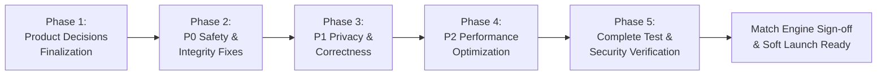

# AMORAA — Match Engine Product Decisions Register

**Document:** `AMORAA_MATCH_ENGINE_PRODUCT_DECISIONS.md`  
**Project:** AMORAA Dating Application  
**Repository:** `D:\Projects\amora_ai`  
**Author:** DeepMind Agentic Coding Assistant (Antigravity)  
**Date:** November 2026  
**Status:** ALL DECISIONS PENDING PRODUCT OWNER APPROVAL (Strictly Read-Only Analysis)

---

## Executive Overview

Technical remediation of the AMORAA Match Engine requires explicit alignment on core product, safety, legal, and operational policies. This document details all ten product decisions, the trade-offs of each available option, the recommended safe defaults, and the implementation dependencies required for the upcoming soft launch.

> [!IMPORTANT]
> **Governance Notice:** Every decision in this register has the final status of **`PENDING PRODUCT OWNER APPROVAL`**. No recommendation is treated as approved until the Product Owner explicitly authorizes its execution. No application source code, configuration, or database schemas have been modified.

---

## Product Decisions Register

---

### Decision 1: Immediate Discovery Suppression on Report

- **Question for Product Owner:** When User A reports User B, should User B be immediately suppressed from User A's discovery feed and recommendations?
- **Available Options:**
  - **Option 1A (Current Implementation):** Do not suppress. Reports remain purely administrative moderation cases; the reported user continues appearing in the reporter's feed unless User A separately blocks User B.
  - **Option 1B (Recommended Default):** **Immediate Mutual Suppression.** The moment User A submits a report against User B, User B is immediately excluded from User A's Discover feed, AI Matches, and recommendations via a database anti-join.
  - **Option 1C:** **Immediate Platform-Wide Suspension.** User B is hidden from *all* users upon receiving a single report.
- **Consequences & Technical Implications:**
  - *Option 1A:* Creates severe user friction. Victims of harassment or fake profiles are forced to view the reported user repeatedly, leading to safety escalations and negative app store reviews.
  - *Option 1B:* Maximizes user safety and trauma prevention while aligning with industry standards (e.g., Hinge, Bumble). Requires adding `notReportedUserSql` anti-join to `discoverController.js`. Slight query overhead is mitigated by index coverage on `Reports (reporterUserId, reportedUserId)`.
  - *Option 1C:* Introduces extreme vulnerability to malicious mass-reporting attacks where legitimate users are abruptly de-platformed without human review.
- **Recommended Default:** **Option 1B (Immediate Mutual Suppression between Reporter and Reported User).**
- **Decision Status:** `PENDING PRODUCT OWNER APPROVAL`

---

### Decision 2: Incomplete Reciprocal Preferences Handling

- **Question for Product Owner:** If Candidate B has not specified an `interestedIn` gender preference (i.e. left blank during onboarding), should Candidate B be eligible to appear in User A's feed?
- **Available Options:**
  - **Option 2A (Current Implementation):** **Permissive Inclusion.** In [`discoverEligibilityPolicy.js:205-207`](file:///d:/Projects/amora_ai/Backend/src/services/discoverEligibilityPolicy.js#L205-L207), `null` or empty `interestedIn` arrays on the candidate are explicitly allowed through.
  - **Option 2B (Recommended Default):** **Strict Reciprocal Exclusion.** Any candidate who has not explicitly selected a gender preference that includes the viewer is excluded from the viewer's feed.
  - **Option 2C:** **Default to Heterosexual Inference.** If blank, infer traditional heterosexual matching based on the candidate's stated gender.
- **Consequences & Technical Implications:**
  - *Option 2A:* Candidates appear in feeds where they may have zero romantic interest, leading to wasted swipes, lower mutual match rates, and awkward cross-orientation rejections.
  - *Option 2B:* Guarantees that every profile presented to User A is open to matching with User A's gender. Requires onboarding validation to mandate at least one `interestedIn` selection.
  - *Option 2C:* Presumptuous and exclusionary for LGBTQ+ users; violates modern identity privacy norms.
- **Recommended Default:** **Option 2B (Strict Reciprocal Exclusion; onboarding must mandate at least one `interestedIn` selection).**
- **Decision Status:** `PENDING PRODUCT OWNER APPROVAL`

---

### Decision 3: Rewindability of Confirmed Mutual Matches

- **Question for Product Owner:** If User A likes User B, and that like immediately triggers a mutual match, should User A be allowed to call "Rewind"?
- **Available Options:**
  - **Option 3A (Current Implementation):** Deletes User A's `DiscoverAction` row, but leaves the `Match` and `Conversation` rows intact in the database.
  - **Option 3B (Recommended Default):** **Mutual Matches Cannot Be Rewound.** If a swipe resulted in a confirmed match, `/api/discover/rewind` returns HTTP `409 CANNOT_REWIND_MATCH`. If the user wishes to undo the connection, they must use the explicit "Unmatch" feature.
  - **Option 3C:** **Transactional Full Undo.** Rewinding a match transactionally deletes the `Match`, deletes the `Conversation`, deletes chat messages, and deletes notifications.
- **Consequences & Technical Implications:**
  - *Option 3A:* Severe database state corruption. User B thinks they matched, User A's swipe history says they haven't swiped, and the chat remains half-orphaned.
  - *Option 3B:* Clear relational mental model. Matches are significant social milestones that cannot be silently undone via a deck undo button. Simple validation: check `Match.findOne` before allowing `action.destroy()`.
  - *Option 3C:* Confusing and jarring UX for User B, who may have already received a push notification, opened the match celebration, or drafted a greeting message.
- **Recommended Default:** **Option 3B (Confirmed mutual matches are final; users must use "Unmatch" to disconnect).**
- **Decision Status:** `PENDING PRODUCT OWNER APPROVAL`

---

### Decision 4: Chat History Retention After Unmatch

- **Question for Product Owner:** What data should be retained, for what purpose, and for how long when a user unmatches (`DELETE /api/matches/:matchId`)?
- **Available Options:**
  - **Option 4A (Current Implementation):** Indefinite Orphaned Storage. The conversation is locked (`conversationAccess` returns `null`), but rows remain in `Messages`, `MessageMedia`, and `Conversations` indefinitely without automated lifecycle management.
  - **Option 4B (Recommended Default):** **Immediate Access Severance with Configurable Cold Retention.** The `Match` row is deleted, the conversation is marked `status = 'archived'`, both users lose all read/write access immediately, and data is retained in cold storage for a configurable period (pending formal legal determination) for safety investigations before automated purging.
  - **Option 4C:** **Immediate Hard Deletion.** The conversation, all messages, and media files are hard-deleted (`DELETE FROM Messages`) instantly upon unmatch.
- **Consequences & Technical Implications:**
  - *Option 4A:* Inaccessible orphaned data accumulates in the database; violates privacy storage limitation principles.
  - *Option 4B:* Immediately eliminates user-facing access risks while preserving evidence for harassment investigations or legal subpoenas. Does **not** hardcode an arbitrary retention period (such as 90 days) until legal counsel determines statutory requirements under the Digital Personal Data Protection (DPDP) Act and IT Rules.
  - *Option 4C:* If a user was harassed, blackmailed, or threatened and unmatches to escape, critical evidence for law enforcement or safety moderation is permanently destroyed.
- **Unresolved Product & Legal Decisions Requiring Review:**
  1. *Categories Retained:* Specific retention schedules for text messages vs. uploaded media vs. metadata (timestamps, IP logs) vs. moderation audit records.
  2. *Lawful Basis:* Documenting the legitimate purpose and lawful basis for retention under Section 4 and Section 8 of the Indian DPDP Act.
  3. *Retention Duration:* Establishing statutory-backed retention limits (e.g., 30 days, 90 days, 180 days) rather than engineering assumptions.
  4. *Access Governance:* Defining which internal administrative roles can access unshared archived chat logs and under what subpoena/warrant criteria.
  5. *Interaction with Account Deletion:* Determining whether a Section 12 DPDP erasure request overrides an ongoing safety retention hold.
- **Recommended Default:** **Option 4B (Immediately revoke both users' access upon unmatch; make retention duration a configurable setting `UNMATCH_RETENTION_DAYS`; avoid hardcoding fixed durations until legal review concludes).**
- **Decision Status:** `PENDING PRODUCT OWNER APPROVAL`

---

### Decision 5: Rebranding "AI Matches" $\to$ "Compatibility Matches"

- **Question for Product Owner:** Should the "AI Matches" tab and API endpoint be renamed to reflect its actual deterministic algorithmic nature?
- **Available Options:**
  - **Option 5A:** Retain "AI Matches" branding across mobile UI and marketing.
  - **Option 5B (Recommended Default):** **Rebrand to "Best Matches" / "Compatibility Matches".**
  - **Option 5C:** Integrate an external LLM / embedding provider before launch.
- **Consequences & Technical Implications:**
  - *Option 5A:* Significant regulatory and legal exposure under consumer protection laws, India DPDP Act transparency guidelines, and emerging AI disclosure standards, since no machine learning model operates on this data.
  - *Option 5B:* 100% transparent, legally defensible, and builds authentic user trust. The algorithm is a sophisticated mathematical scoring engine and can be proudly marketed as such without deceptive claims.
  - *Option 5C:* Adds substantial API costs ($0.005–$0.02 per user feed request), increases query latency by 500–2,500 ms, introduces third-party availability risks, and delays the soft launch.
- **Recommended Default:** **Option 5B (Rebrand frontend to "Best Matches" / "Compatibility Matches" for launch).**
- **Decision Status:** `PENDING PRODUCT OWNER APPROVAL`

---

### Decision 6: Match Confidence Metric Definition & Rebranding

- **Question for Product Owner:** How should the metric currently labeled "AI Confidence" be defined, calculated, and displayed to users?
- **Codebase Reality Analysis:**
  - In [`Backend/src/services/aiMatchProvider.js:46`](file:///d:/Projects/amora_ai/Backend/src/services/aiMatchProvider.js#L46):
    $$\text{aiConfidence} = \text{clamp}(0.8 \times \text{coverage} + 0.2 \times \text{support})$$
  - `coverage` is the percentage of the 8 factor weights that both profiles have filled out ($A / 100$).
  - `support` is the weighted agreement score ($\sum w_i v_i / 100$).
  - **Finding:** This metric does **not** measure a statistical probability of dating success, nor machine learning predictive confidence. It is a composite index of **profile data completeness (80%)** and **factor agreement depth (20%)**.
- **Available Options:**
  - **Option 6A:** Retain "AI Confidence" label.
  - **Option 6B (Recommended Default):** **Rename to "Profile Match Depth" or "Compatibility Data Coverage".**
  - **Option 6C:** Remove the confidence metric from the UI entirely for soft launch until validated.
- **Consequences & Technical Implications:**
  - *Option 6A:* Misleading to users; falsely implies that an AI agent calculated the likelihood of relationship success.
  - *Option 6B:* Accurately describes what the formula actually computes (depth of shared profile data).
  - *Option 6C:* Simplifies the UI, avoiding user confusion between "Compatibility Score" and "Confidence Level".
- **Recommended Default:** **Option 6B (Rename to "Profile Match Depth" or Option 6C (Remove from UI for soft launch)).**
- **Decision Status:** `PENDING PRODUCT OWNER APPROVAL`

---

### Decision 7: Rebranding "AI Openers" $\to$ "Conversation Starters"

- **Question for Product Owner:** Should on-device string interpolation openers in [`ai_icebreakers_screen.dart`](file:///d:/Projects/amora_ai/lib/features/ai_coach/presentation/ai_icebreakers_screen.dart) be rebranded?
- **Available Options:**
  - **Option 7A:** Retain "AI Openers" / "AI Icebreakers" branding.
  - **Option 7B (Recommended Default):** **Rename to "Smart Starters" or "Conversation Starters".**
  - **Option 7C:** Route icebreaker generation through a cloud LLM (e.g. Gemini 1.5 Flash).
- **Consequences & Technical Implications:**
  - *Option 7A:* Inaccurate; openers are static template strings like `"$firstName, I noticed you enjoy $interest..."`.
  - *Option 7B:* The screen already contains the honest subtitle *"Created on-device from visible profile details."* Rebranding aligns the header with the existing disclosure.
  - *Option 7C:* Generates truly personalized openers, but introduces recurring API costs, latency, and content safety moderation overhead.
- **Recommended Default:** **Option 7B (Rename to "Conversation Starters").**
- **Decision Status:** `PENDING PRODUCT OWNER APPROVAL`

---

### Decision 8: Long-Term AI Roadmap Architecture

- **Question for Product Owner:** Should AMORAA's match engine remain rule-based permanently, or adopt actual AI in Phase 3?
- **Available Options:**
  - **Option 8A (Recommended Default):** **Hybrid Architecture (Rule-based Hard Filter + AI Semantic Re-Ranker in Phase 3).**
  - **Option 8B:** **Pure Rule-Based Forever.** Never adopt LLMs or embeddings.
  - **Option 8C:** **Full Generative AI Matchmaking.** Prompt an LLM with full user profiles to pick matches.
- **Consequences & Technical Implications:**
  - *Option 8A:* Best-in-class approach. Retains deterministic SQL performance for 100% of safety and demographic filters (age, distance, gender, blocks). In Phase 3 post-launch, introduces lightweight embeddings (e.g., text-embedding-3-small) to compute semantic similarity over free-text bios and prompts.
  - *Option 8B:* Zero AI operational costs, but misses opportunities for nuanced personality and lifestyle alignment from free-text bios.
  - *Option 8C:* Catastrophically expensive, high latency, non-deterministic, and prone to demographic bias and hallucination.
- **Recommended Default:** **Option 8A (Hybrid Architecture planned for Phase 3 post-launch).**
- **Decision Status:** `PENDING PRODUCT OWNER APPROVAL`

---

### Decision 9: Permitted Rewind Time Window

- **Question for Product Owner:** How long after an action should a user be permitted to "Rewind"?
- **Available Options:**
  - **Option 9A (Current Implementation):** **Infinite.** User can rewind their last action days or weeks later if they have not swiped since.
  - **Option 9B (Recommended Default):** **15-Minute Window.** A swipe can only be rewound within 15 minutes of being made.
  - **Option 9C:** **Immediate Card Only.** Rewind is only allowed for the immediately preceding card; closing or backgrounding the app voids rewind.
- **Consequences & Technical Implications:**
  - *Option 9A:* Stale actions rewound long after the other user moved on; odd behavioral edge cases.
  - *Option 9B:* Protects immediate accidental swipes (e.g. thumb slipped left instead of right) while preventing historical manipulation. Simple validation: `action.createdAt >= NOW() - 15m`.
  - *Option 9C:* Frustrating if the app momentarily pauses or reloads.
- **Recommended Default:** **Option 9B (15-Minute Expiration Window).**
- **Decision Status:** `PENDING PRODUCT OWNER APPROVAL`

---

### Decision 10: Relationship Behavior on BLOCK vs. REPORT

- **Question for Product Owner:** What specific actions should occur when a user executes a BLOCK versus a REPORT against another user?
- **Critical Policy Distinction:** **BLOCK and REPORT must have distinct operational behaviors.** Lumping them together creates either safety risks or report abuse vulnerabilities.

#### Policy 10.1: BLOCK Specification (Defensive Personal Isolation)
- **Primary Purpose:** Immediate, permanent, bilateral severance initiated by the user.
- **Recommended System Actions:**
  1. **Match Severance:** The active `Matches` record is permanently deleted or marked `revoked`.
  2. **Conversation Access:** Direct conversation access is severed immediately for both users; no further messages can be sent or read.
  3. **Mutual Discovery Suppression:** Both profiles are completely hidden from each other across Discover, AI Matches, and all recommendation endpoints.
  4. **Realtime Disconnection:** Active WebSocket subscriptions and push notification tokens associated with the pair are unlinked immediately.
  5. **API Circumvention Prevention:** `areUsersBlocked()` checks are enforced across all direct-interaction endpoints (swiping, messaging, profile view, roses).
  - *Rationale:* Protects user autonomy and physical/emotional safety without requiring moderation intervention.

#### Policy 10.2: REPORT Specification (Community Safety & Moderation)
- **Primary Purpose:** Alerting moderators to violations of terms, harassment, or illegal conduct.
- **Recommended System Actions:**
  1. **Reporter Discovery Suppression:** Immediately hide the reported profile from the *reporter's* discovery feed and recommendations.
  2. **Moderation Case Creation:** Create an administrative case in `AdminReportCases` capturing evidence, reported reason, timestamps, and recent message snippets.
  3. **No Automatic Account Suspension:** Do **not** automatically suspend the reported account platform-wide based on a single report (prevents weaponized false reporting).
  4. **No Automatic Bilateral Severance:** Do **not** automatically dissolve an active match or conversation solely because a report was filed, *unless* the reporter also chooses to Block.
  5. **Integrated "Report & Block" Prompt:** When filing a report, prompt the user: *"Would you also like to block this user immediately?"* If selected, the complete BLOCK policy applies simultaneously.
  - *Rationale:* Protects the reporting user from seeing the offender while preventing malicious actors from weaponizing reports to unilaterally destroy other users' matches without administrative review.

- **Available Options:**
  - **Option 10A:** Treat Block and Report identically (both cause immediate account suspension and bilateral destruction).
  - **Option 10B (Recommended Default):** **Separate Block (Immediate Bilateral Severance) from Report (Reporter Suppression + Moderation Case + Optional Block Prompt).**
  - **Option 10C:** Soft Block only (messages muted, but profile remains visible).
- **Recommended Default:** **Option 10B (Distinct separation: Block = complete bilateral severance; Report = reporter suppression + moderation ticket + optional block prompt).**
- **Decision Status:** `PENDING PRODUCT OWNER APPROVAL`

---

## 3. Implementation Dependency & Approval Matrix

The following matrix identifies the exact product decisions that serve as strict prerequisites for each technical implementation phase:

```
┌──────────────────────────────────────────────────────────────────────────────────┐
│                           APPROVAL & DEPENDENCY MATRIX                           │
├────────────────────┬──────────────────────────────────────┬──────────────────────┤
│ Engineering Phase  │ Required Product Decision Approval   │ Blocking Impact      │
├────────────────────┼──────────────────────────────────────┼──────────────────────┤
│ Phase P0 (Safety)  │ Decision 1 (Report Suppression)      │ Blocks discover feed │
│                    │ Decision 2 (Reciprocal Preferences)  │ Blocks swipe valid.  │
│                    │ Decision 3 (No Rewind of Matches)    │ Blocks rewind API    │
│                    │ Decision 10 (Block vs. Report)       │ Blocks safety routes │
├────────────────────┼──────────────────────────────────────┼──────────────────────┤
│ Phase P1 (Privacy) │ Decision 4 (Chat Retention Policy)   │ Blocks unmatch logic │
│                    │ Decision 9 (15-min Rewind Window)    │ Blocks rewind policy │
│                    │ Decision 5 (Compatibility Rebrand)   │ Blocks UI text/routes│
│                    │ Decision 6 (Match Depth Rebrand)     │ Blocks card badges   │
│                    │ Decision 7 (Starters Rebrand)        │ Blocks openers screen│
├────────────────────┼──────────────────────────────────────┼──────────────────────┤
│ Phase P2 (Perf)    │ Decision 8 (Hybrid Roadmap Scope)    │ Informs index design │
└────────────────────┴──────────────────────────────────────┴──────────────────────┘
```

---

## 4. Phased Match Engine Completion Roadmap

The project must strictly adhere to the following sequence. Soft launch preparation must **not** begin until Phase 5 verification has passed.



### Phase 1 — Product Decisions Finalization (CURRENT STEP)
- Review and finalize all 10 decisions in this document.
- Resolve legal questions regarding chat data retention.
- Obtain formal, explicit Product Owner sign-off.

### Phase 2 — P0 Safety and Integrity Implementation
- Implement reciprocal eligibility validation in `POST /api/discover/swipe`.
- Implement `notReportedUserSql` discovery feed suppression.
- Implement mutual match rewind restriction (HTTP 409) and rewind rate limiting.
- Enforce the distinct Block vs. Report operational policies.

### Phase 3 — P1 Privacy and Correctness Implementation
- Implement AES-256-GCM encrypted pagination cursors with coarsened distance keys.
- Enforce the 15-minute rewind expiration window.
- Implement immediate chat access revocation upon unmatch with configurable retention.
- Update frontend UI labels (Best Matches, Match Depth, Conversation Starters).

### Phase 4 — P2 Performance Optimization
- Optimize candidate queries by pushing hard-filter evaluations ahead of scoring.
- Reduce AI candidate window from 500 to 50 with lean column projections.
- Review database index coverage for MySQL 8.0 / MariaDB.

### Phase 5 — Complete Verification & Sign-Off
- Execute full 68-test scenario suite (`AMORAA_MATCH_ENGINE_TEST_PLAN.md`).
- Run IDOR and security penetration tests.
- Execute isolated staging concurrency and load tests (100–1,000 req/s).
- Deliver final Match Engine sign-off report before soft-launch authorization.
